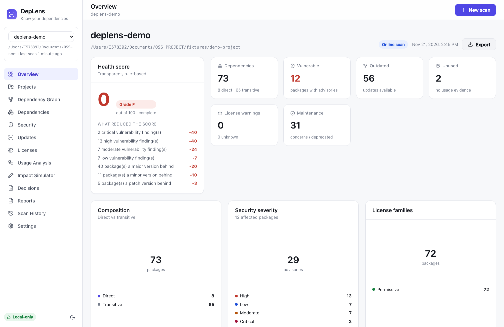
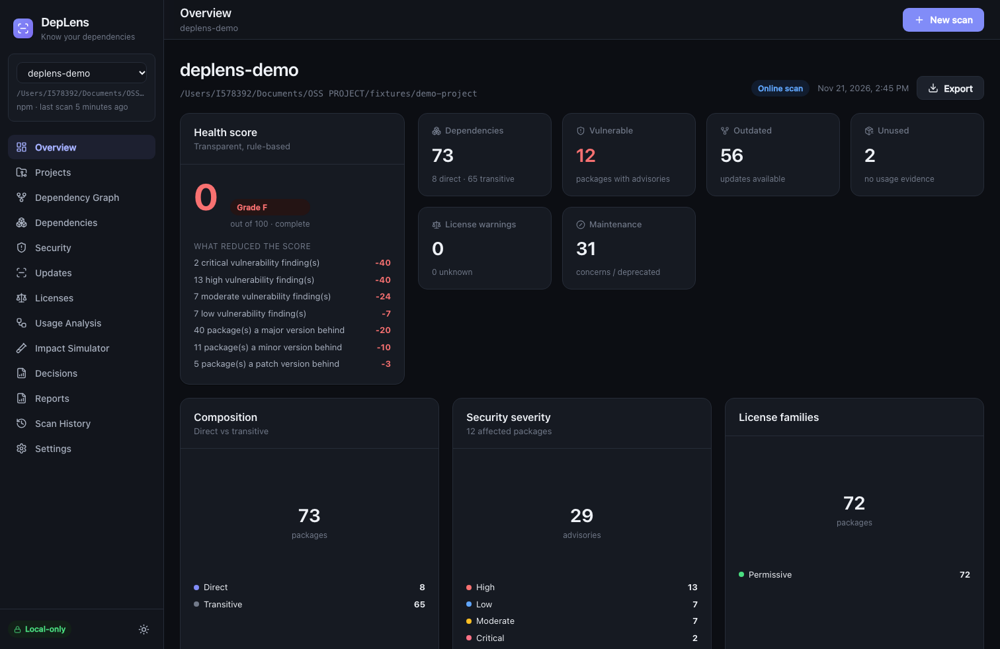
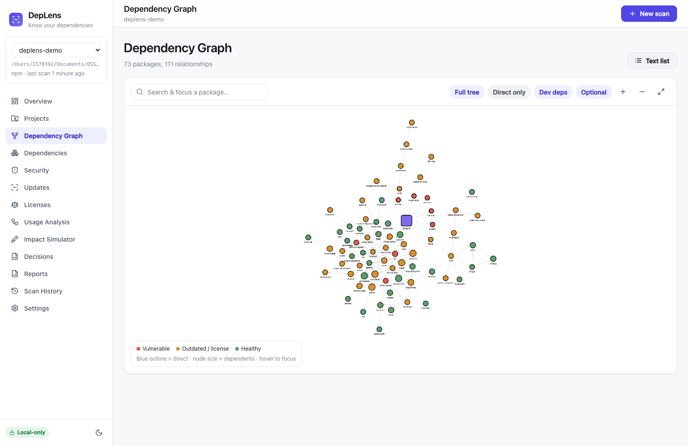
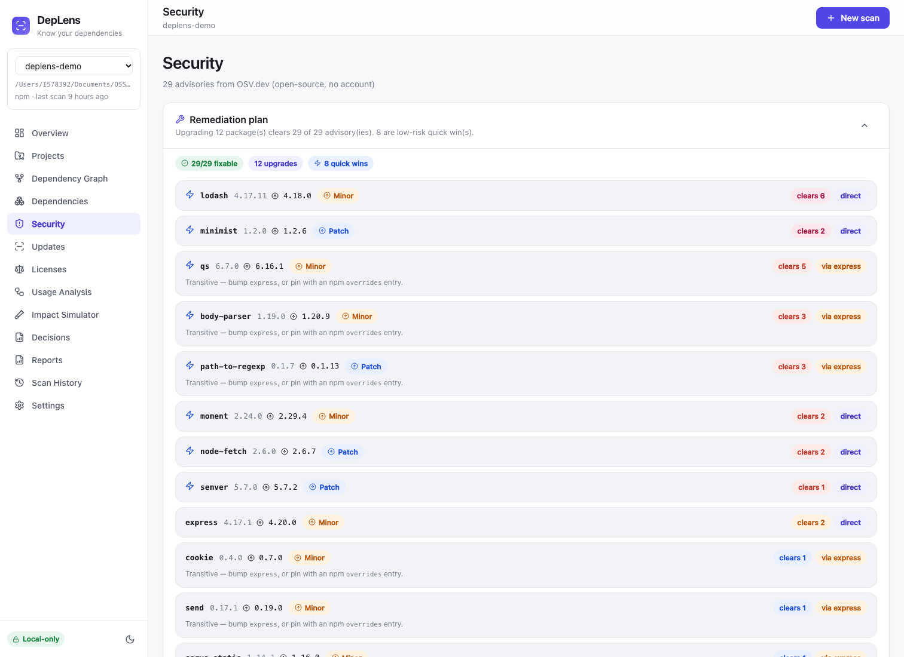
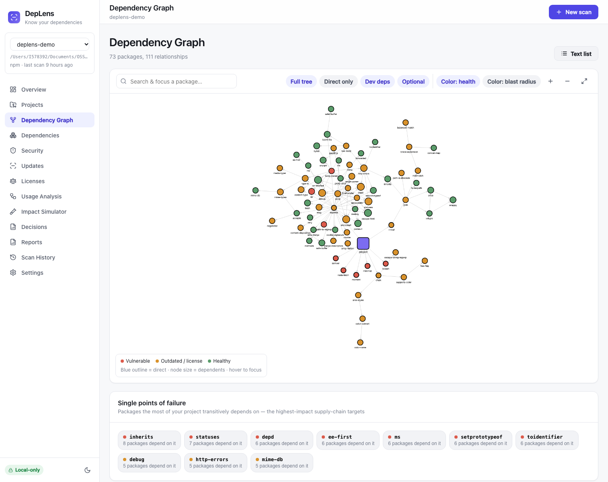
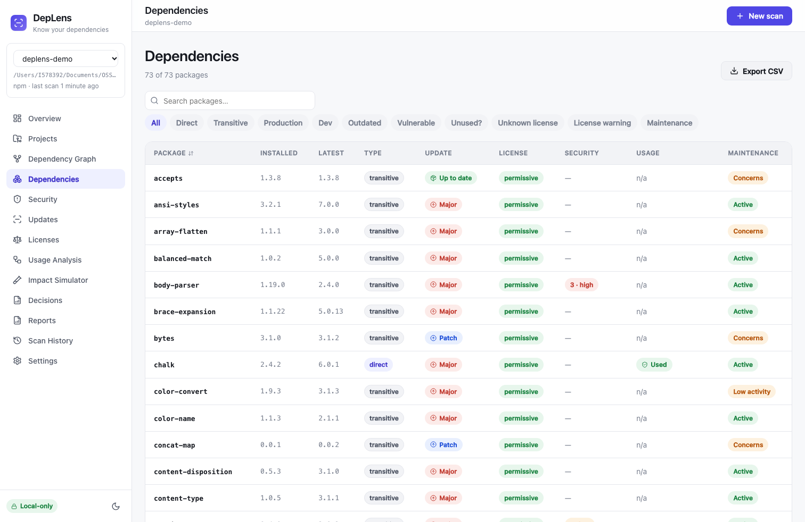

<div align="center">

# DepLens

### Know what your project depends on.

**A local-first, open-source dependency health explorer for npm projects.**

Dependencies aren't just packages — they're decisions. DepLens turns a complicated
dependency tree into an understandable, actionable engineering workspace: scan a project,
understand its graph, investigate findings with evidence, simulate a change before you make
it, record the decision, and track what to verify.

[Features](#features) · [Screenshots](#screenshots) · [Quick start](#quick-start) · [How it works](#how-it-works) · [Privacy](#privacy) · [Docs](#documentation)

  

</div>

---

## The problem

Modern JavaScript projects pull in hundreds of transitive dependencies. Each one is a
decision about security, licensing, maintenance and long-term risk — but those decisions are
usually invisible. Existing tools tend to be either a raw vulnerability scanner or a flat
package list, and they rarely explain *why* something is a problem, *where* it comes from, or
*what you should verify* before acting.

## The solution

DepLens is built around one workflow:

> **SCAN → UNDERSTAND → INVESTIGATE → SIMULATE → DECIDE → VERIFY**

Every finding is explainable. For any dependency problem you can see what was detected, why,
what evidence supports it, where the dependency comes from, which packages rely on it, what
action to consider, and what to check before taking it. When data is missing, DepLens says so
("unknown", "not analyzed", "offline") rather than guessing.

It is **local-first**: your source code never leaves your machine, there is no account, no
login, and no telemetry. Core analysis is deterministic and works offline; online checks send
only package names and versions to public, open-source services.

## Features

- **Real dependency resolution** — parses `package.json` and `package-lock.json`
  (lockfile versions 1, 2 and 3), reconstructing the resolved tree with npm's own
  `node_modules` resolution. No hardcoded edges.
- **Interactive dependency graph** — a Cytoscape.js workspace with search, focus, filters,
  zoom, a legend, and a textual alternative for accessibility. Nodes encode health and
  severity; size encodes how many packages depend on them.
- **Security analysis** — real advisories from [OSV.dev](https://osv.dev) (open-source, no
  key). Shows severity, the CVE, the dependency path, the fixed version for *your* installed
  line, and why the package is present. Never invents CVEs; never marks a package "secure"
  when it wasn't checked.
- **Update intelligence** — semver-aware classification of patch / minor / major / prerelease
  updates against the registry's latest release.
- **Remediation Planner** — turns the advisory list into a ranked, minimal upgrade plan: for
  each vulnerable package the single version that clears the most advisories, its risk
  (patch/minor/major), and — crucially — whether it's a direct bump or a transitive fix that
  needs an npm `overrides` entry. Flags low-risk "quick wins".
- **One-click Apply fix** — apply a remediation as a precise `package.json` edit (operator-
  preserving bumps for direct deps, `overrides` for transitive). Copy/patch mode touches
  nothing on disk; an opt-in, confirmed write mode edits the file and keeps a `.bak` backup.
  DepLens **never runs `npm install`** — you run that yourself.
- **Supply-chain blast radius** — ranks packages by how much of your tree transitively depends
  on them (NetworkX reachability), surfacing the "single points of failure" a compromise would
  poison most. Switch the graph to colour nodes by blast radius.
- **License analysis** — heuristic SPDX family classification against a configurable policy
  (permissive / weak-copyleft / copyleft / proprietary / unknown). Not legal advice.
- **Usage analysis** — finds import / require / dynamic-import evidence in your source, with
  calibrated confidence. DepLens never claims a package is unused with certainty.
- **Dependency Impact Simulator** — model an upgrade, removal or replacement *before* doing
  it. Finds version-constraint conflicts from declared ranges, affected packages and files,
  advisories a change would resolve, and the transitive subtree a removal would prune. Every
  finding is labelled by evidence class (lockfile / static / potential / unknown).
- **Decision workspace & verification checklists** — record a decision with its evidence and
  a generated, editable verification checklist; track status over time.
- **Transparent health score** — a documented, rule-based score (0–100) that shows exactly
  which findings reduced it, and is marked "partial" when analysis was incomplete — never
  inflated. See [docs/scoring-model.md](docs/scoring-model.md).
- **Scan history & comparison** — diff two scans: added / removed / updated packages, new and
  resolved advisories, and health change.
- **Reports** — export Markdown, JSON, or CSV, including limitations and data sources.
- **Polished UI** — elegant light and dark themes, responsive layout, loading skeletons,
  empty states, and keyboard-accessible controls.

## Screenshots

> Captured from the running application analyzing the bundled demo fixture — not mockups.

**Overview dashboard** (light & dark)




**Interactive dependency graph**



**Security analysis & remediation plan** (real OSV advisories + ranked fix plan)



**Supply-chain blast radius** (single points of failure, graph-native)



**Dependency explorer**



## Supported ecosystems

| Ecosystem | Manifest | Lockfile | Status |
| --- | --- | --- | --- |
| Node.js / npm | `package.json` | `package-lock.json` (v1, v2, v3) | ✅ Supported |
| PyPI, Cargo, … | — | — | 🗺️ Planned (see [roadmap](docs/roadmap.md)) |

## Quick start

**Prerequisites:** Python 3.9+ and Node.js 18+.

```bash
# 1. Backend — create a venv and install
cd backend
python -m venv .venv
.venv/bin/pip install -r requirements-dev.txt

# 2. Build the frontend (served by the backend)
cd ../frontend
npm install
npm run build

# 3. Run DepLens
cd ../backend
.venv/bin/python -m deplens serve
# open http://127.0.0.1:8000
```

Click **New scan** — the bundled demo fixture at `fixtures/demo-project` is pre-filled, so you
can see real analysis immediately. Or point it at any local npm project folder.

**CLI** (no UI):

```bash
.venv/bin/python -m deplens scan /path/to/your/project
.venv/bin/python -m deplens scan /path/to/your/project --offline   # no network
```

### Development

Run the two dev servers side by side (the Vite dev server proxies `/api` to the backend):

```bash
# terminal 1
cd backend && .venv/bin/python -m deplens serve --reload
# terminal 2
cd frontend && npm run dev     # http://localhost:5173
```

See [docs/development.md](docs/development.md) for details.

## How it works

```
  package.json ─┐
                ├─▶ parsers ─▶ resolver + graph (NetworkX) ─▶ analyzers ─▶ SQLite ─▶ API ─▶ React UI
  package-lock ─┘                                              │
                                                               ├─ versions   (npm registry)
                                                               ├─ security   (OSV.dev)
                                                               ├─ licenses   (SPDX + policy)
                                                               ├─ usage      (local source scan)
                                                               ├─ maintenance(registry metadata)
                                                               └─ health     (deterministic score)
```

- **Backend:** Python · FastAPI · Pydantic · SQLite · NetworkX · httpx.
  The semver engine, lockfile resolver, graph engine and all analyzers are implemented from
  scratch (see [docs/dependency-analysis.md](docs/dependency-analysis.md)).
- **Frontend:** React · TypeScript · Vite · Cytoscape.js · Recharts.
- **Security:** scanned repositories are treated as untrusted input — DepLens never executes
  project code, never runs lifecycle scripts, never runs `npm install`, validates paths
  against traversal, refuses to follow symlinks out of the project, and caps file sizes.
  See [docs/security.md](docs/security.md).

## Privacy

DepLens is local-first and discloses every external request:

| Data | Where it goes |
| --- | --- |
| Your source code, file contents, project names, personal data | **Nowhere** — never leaves your machine |
| Package **names** | npm registry (versions, licenses, publish times) |
| Package **names + versions** | OSV.dev (vulnerability advisories) |

Offline mode disables all network calls. There is no telemetry, account, or login.
See [docs/privacy.md](docs/privacy.md).

## Testing

```bash
cd backend && .venv/bin/python -m pytest        # backend unit + integration tests
cd backend && .venv/bin/ruff check deplens      # backend lint
cd frontend && npm test                          # frontend unit tests
cd frontend && npm run typecheck && npm run lint # frontend typecheck + lint
```

Tests run offline and deterministically against the committed demo fixture.

## Limitations

DepLens is honest about what it cannot do:

- Usage analysis cannot *prove* a package is unused (dynamic loading, plugins, framework
  conventions). It reports evidence and confidence, never certainty.
- The health score is a prioritisation aid, **not** a validated risk probability.
- License classification is heuristic and is **not** legal advice.
- Security status is "unknown" (not "secure") whenever advisories weren't checked.
- Maintenance signals use publish timestamps and deprecation flags; a stable, rarely-updated
  package may be flagged for review even though it is fine.

## Roadmap

See [docs/roadmap.md](docs/roadmap.md). Planned: additional ecosystems (PyPI, Cargo), SBOM
export (CycloneDX / SPDX), package-size analysis, and *optional, never-required* local-LLM
assistance.

## Contributing

Contributions are welcome! Please read [CONTRIBUTING.md](CONTRIBUTING.md) and the
[Code of Conduct](CODE_OF_CONDUCT.md). New dependencies must be MIT/BSD/Apache-2.0/ISC
compatible and documented.

## License

MIT © The DepLens Authors. See [LICENSE](LICENSE) and
[THIRD_PARTY_NOTICES.md](THIRD_PARTY_NOTICES.md).

## Documentation

- [Architecture](docs/architecture.md)
- [Dependency analysis](docs/dependency-analysis.md)
- [Scoring model](docs/scoring-model.md)
- [Privacy](docs/privacy.md) · [Security](docs/security.md) · [License policy](docs/license-policy.md)
- [User guide](docs/user-guide.md) · [Development](docs/development.md)
- [Originality](docs/originality.md) · [Roadmap](docs/roadmap.md)
